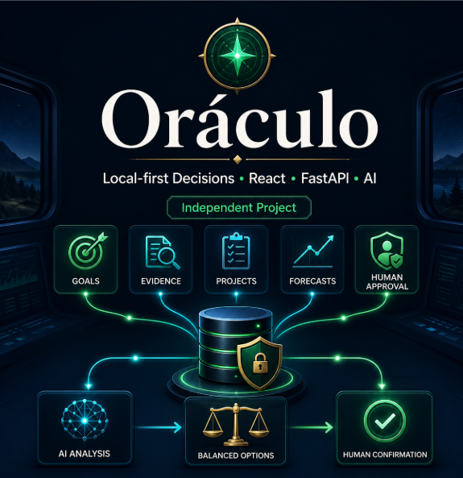

# ORÁCULO

### AI Decision Operating System

> **Don't just ask AI what to do. Build a system that learns whether its decisions were right.**

Oráculo is an **open-source, local-first decision intelligence system** designed to turn goals, evidence, hypotheses, alternatives, predictions and outcomes into an auditable decision loop.

Instead of treating an LLM as a generic advisor, Oráculo combines:

**structured context → evidence → deterministic scoring → AI reasoning → red team → human decision → measured outcome → calibration**

The long-term goal is to evolve Oráculo from a decision operating system into a **personal digital twin for scenario simulation and probabilistic decision support**.

<p align="center">
  
</p>

<p align="center">
  <a href="https://github.com/LeoBarreto38/oraculo-decision-os/actions/workflows/ci.yml"></a>
  
  
  
  
</p>

<p align="center">
  <a href="#quick-start">Quick start</a> ·
  <a href="docs/USER-GUIDE.md">User guide</a> ·
  <a href="docs/INSTALLATION.md">Installation</a> ·
  <a href="CONTRIBUTING.md">Contributing</a> ·
  <a href="ROADMAP.md">Roadmap</a>
</p>

---

## Why Oráculo?

Most AI assistants answer a question and forget whether the advice actually worked.

Oráculo is built around a different idea:

> **Every important decision should create data that improves future decisions.**

A decision in Oráculo can contain:

- goals;
- current context;
- alternative options;
- personal or operational evidence;
- current market evidence;
- assumptions;
- deterministic scores;
- AI analysis;
- adversarial red-team analysis;
- explicit probability estimates;
- a final human choice;
- an observed outcome;
- calibration metrics.

The model does not silently become the authority.

**The human remains the final decision-maker.**

---

## The Decision Loop

```text
REALITY
   ↓
GOALS
   ↓
EVIDENCE
   ↓
HYPOTHESES
   ↓
OPTIONS
   ↓
DETERMINISTIC ANALYSIS
   ↓
AI REASONING
   ↓
RED TEAM
   ↓
RECOMMENDATION
   ↓
HUMAN DECISION
   ↓
REAL-WORLD OUTCOME
   ↓
CALIBRATION
   ↺
```

The objective is not to make AI sound more confident.

The objective is to make decisions **more measurable, falsifiable and auditable**.

---

# Current Features

## Decision Engine

Create structured decisions with:

- multiple alternatives;
- expected upside and downside;
- financial cost;
- time cost;
- reversibility;
- strategic alignment;
- evidence strength;
- execution risk;
- opportunity cost;
- uncertainty;
- personal-pattern risk.

Scores are treated as **comparative decision aids**, not objective probabilities.

---

## AI Analysis

Oráculo can use OpenAI models through the Responses API to analyze a decision using selected context from the local system.

The AI is instructed to explicitly return:

- recommendation;
- reasoning;
- evidence;
- assumptions;
- principal risk;
- what would change the recommendation;
- confidence in the evidence;
- next action;
- review date.

The application tracks token usage and estimated API cost.

---

## Red Team

Critical decisions can be subjected to a separate adversarial analysis.

The red team is asked to challenge:

- fragile assumptions;
- hidden costs;
- confirmation bias;
- ignored alternatives;
- underestimated risk;
- false precision.

Its goal is **not to agree with the primary recommendation**.

Its job is to try to break it.

---

## Evidence Tracking

Evidence can be registered as:

- personal data;
- market data;
- experiment;
- observation;
- model inference;
- user statement.

Evidence can support or contradict specific alternatives and carries:

- reliability;
- freshness;
- source;
- capture date.

This makes it possible to distinguish:

> what the system **knows**

from

> what the model **infers**.

---

## Hypotheses

Oráculo treats uncertain beliefs as hypotheses rather than facts.

A hypothesis can contain:

- prior probability;
- current probability;
- test definition;
- success condition;
- failure condition;
- final resolution.

This creates a bridge between strategy and experimentation.

---

## Predictions & Calibration

Predictions can be recorded **before** their outcome is known.

When the result becomes observable, Oráculo can calculate metrics such as:

- Brier Score;
- prediction error;
- accuracy by category;
- probability calibration ranges.

When insufficient observations exist, the system explicitly reports:

> **INSUFFICIENT DATA FOR CALIBRATION**

instead of inventing statistical confidence.

---

## Goals, Projects & Tasks

The system connects daily execution to higher-level strategy.

Tasks can be classified as:

- `CASH`
- `ASSET`
- `LEARNING`
- `MAINTENANCE`
- `DISTRACTION`

The objective is to expose an important question:

> **Is today's activity actually moving the strategy forward?**

---

## Daily Check-ins

Oráculo includes a daily operational loop.

Record:

- what was completed;
- what was not completed;
- what blocked execution;
- what changed;
- what was learned;
- whether new information should change the strategy.

Over time, this creates a factual history of execution rather than a memory reconstructed after the fact.

---

## Alerts

The deterministic alert engine can detect conditions such as:

- overdue decisions;
- expired hypotheses;
- projects without external validation;
- excessive technical work during a validation phase;
- conflicting project priorities;
- strategic drift.

AI is not required for these rules.

---

## Knowledge Graph

Goals, projects, decisions, hypotheses and evidence can be represented as connected entities.

The current graph is intentionally simple.

The long-term direction is to evolve it into a richer **operational ontology** representing relationships between:

- people;
- projects;
- objectives;
- capital;
- opportunities;
- decisions;
- evidence;
- external entities;
- outcomes.

---

# Local-First by Design

Oráculo is designed to work locally.

Current stack:

| Layer | Technology |
|---|---|
| Backend | Python 3.12 + FastAPI |
| Data | SQLite |
| ORM | SQLAlchemy |
| Frontend | React + TypeScript |
| Build | Vite |
| UI | Tailwind CSS |
| Graph | React Flow |
| Charts | Recharts |
| Scheduler | APScheduler |
| AI | OpenAI Responses API |
| App model | Local-first PWA |

No Docker is required.

No cloud database is required.

No permanent server is required.

---

# Architecture

```text
┌───────────────────────────┐
│       React / PWA         │
│                           │
│ Dashboard                 │
│ Today                     │
│ Decisions                 │
│ Projects                  │
│ Goals                     │
│ Hypotheses                │
│ Knowledge Graph           │
│ Journal                   │
│ Oracle Chat               │
└─────────────┬─────────────┘
              │
              ▼
┌───────────────────────────┐
│          FastAPI          │
├───────────────────────────┤
│ Decision Engine           │
│ Context Builder           │
│ Evidence Engine           │
│ Model Router              │
│ Red Team                  │
│ Analytics                 │
│ Scheduler                 │
│ Backup                    │
└─────────────┬─────────────┘
              │
       ┌──────┴──────┐
       ▼             ▼
┌──────────────┐ ┌───────────────┐
│    SQLite    │ │  AI Providers │
│              │ │               │
│ Local state  │ │ OpenAI        │
│ Decisions    │ │ Future: other │
│ Evidence     │ │ providers     │
│ Predictions  │ └───────────────┘
└──────────────┘
```

---

# Quick Start

## Requirements

- Python 3.12+
- Node.js 20+
- Git
- Windows, Linux or macOS

An OpenAI API key is optional for the deterministic/local parts of Oráculo and required for AI-powered analysis.

---

## Clone

```bash
git clone https://github.com/LeoBarreto38/oraculo-decision-os.git
cd oraculo-decision-os
```

---

## Windows

Run:

```text
install-oraculo.bat
```

Then:

```text
start-oraculo.bat
```

Open:

```text
http://127.0.0.1:8000
```

---

## Linux / macOS

```bash
cd backend

python3 -m venv .venv

. .venv/bin/activate

python -m pip install -r requirements.txt

python -m app.cli init-db

cd ../frontend

corepack enable

pnpm install --frozen-lockfile

pnpm run build

cd ../backend

python -m uvicorn app.main:app \
  --host 127.0.0.1 \
  --port 8000
```

Open:

```text
http://127.0.0.1:8000
```

---

# Configuration

Copy:

```text
.env.example
```

to:

```text
.env.local
```

Main variables include:

```text
OPENAI_API_KEY=

ORACULO_TIMEZONE=UTC

ORACULO_DATA_DIR=data

ORACULO_DATABASE_URL=

ORACULO_CORS_ORIGINS=
```

Never commit `.env.local`.

---

# Safe Demo Data

A new empty installation contains only a small neutral demo dataset.

Example entities include:

```text
DEMO: Demo User

DEMO: Reach first measurable objective

DEMO: Example Project

DEMO: Allocate time between two example strategies
```

The public seed is never applied over an existing non-empty database.

Your personal state remains your personal state.

---

# Privacy

Oráculo is local-first, but local-first does not automatically mean private under every configuration.

Important considerations:

- SQLite data is local by default;
- local databases are not encrypted at rest by Oráculo v0;
- API keys remain backend-only;
- selected context may be transmitted to external AI providers;
- web research may send search queries externally;
- private exports and backups should never be committed to Git.

The context builder is designed to send only information relevant to the current analysis rather than blindly forwarding the entire database.

---

# Human Authority

Oráculo is a **decision-support system**, not an autonomous authority.

It must not autonomously:

- spend money;
- send external messages;
- sign contracts;
- execute irreversible actions;
- make medical, legal or financial decisions on behalf of a user.

Recommendations should expose:

**evidence, uncertainty and assumptions.**

The final decision belongs to the human.

---

# Running Tests

Backend:

```bash
cd backend
python -m pytest -q
```

Frontend:

```bash
cd frontend
pnpm run typecheck
pnpm run build
```

Additional documentation:

- [Installation](docs/INSTALLATION.md)
- [User Guide](docs/USER-GUIDE.md)
- [Troubleshooting](docs/TROUBLESHOOTING.md)
- [Operations](docs/OPERACAO.md)
- [Acceptance Tests](docs/TESTE-DE-ACEITE.md)
- [Security & Decision Rules](docs/SEGURANCA-E-DECISOES.md)

---

# Backup

With the backend environment activated:

```bash
python -m app.cli backup
```

Private databases, backups and exports are ignored by Git.

---

# Roadmap

Oráculo is currently an early-stage experimental system.

## v0 — Decision OS

- [x] Goals
- [x] Projects
- [x] Tasks
- [x] Structured decisions
- [x] Evidence
- [x] Hypotheses
- [x] AI analysis
- [x] Red Team
- [x] Predictions
- [x] Brier Score
- [x] API cost tracking
- [x] Local backups
- [x] Knowledge graph
- [x] PWA

## v1 — Personal Ontology

- [ ] richer object relationships;
- [ ] temporal state;
- [ ] event history;
- [ ] reusable decision templates;
- [ ] provider abstraction;
- [ ] deeper evidence provenance.

## v2 — Digital Twin

- [ ] explicit state snapshots;
- [ ] historical state reconstruction;
- [ ] forkable hypothetical states;
- [ ] scenario comparison.

## v3 — Scenario Engine

- [ ] what-if simulations;
- [ ] sensitivity analysis;
- [ ] constraint modeling;
- [ ] expected-value scenarios.

## v4 — Probabilistic Twin

- [ ] Monte Carlo simulation;
- [ ] Bayesian updating;
- [ ] forecasting;
- [ ] probability distributions;
- [ ] risk-of-ruin analysis.

## v5 — Multi-Agent Council

- [ ] specialized reasoning roles;
- [ ] independent model providers;
- [ ] financial strategist;
- [ ] technical strategist;
- [ ] growth strategist;
- [ ] adversarial critic;
- [ ] synthesis layer.

The roadmap is intentionally incremental.

**More compute is not a substitute for better data.**

---

# What Oráculo Is Not

Oráculo is not:

- another ChatGPT wrapper;
- a productivity todo list with AI;
- an autonomous life controller;
- a system that claims to predict the future;
- a substitute for professional advice.

It is an experiment in building **measurable decision intelligence around a human operator**.

---

# Contributing

Contributions are welcome.

Useful areas include:

- new AI providers;
- local model support;
- statistical modules;
- visualization;
- knowledge graph improvements;
- scenario simulation;
- testing;
- security;
- documentation;
- accessibility;
- cross-platform installation.

Before submitting major architectural changes, please open an Issue or Discussion first.

See:

[CONTRIBUTING.md](CONTRIBUTING.md)

---

# Project Principles

1. **Reality over narrative.**
2. **Evidence over enthusiasm.**
3. **Outcomes over activity.**
4. **Uncertainty must be explicit.**
5. **Reversible decisions can move faster.**
6. **Irreversible decisions require stronger evidence.**
7. **AI recommendations must remain auditable.**
8. **Human authority is final.**
9. **Predictions should eventually meet outcomes.**
10. **The system should learn when it was wrong.**

---

# License

Oráculo is licensed under the **GNU Affero General Public License v3.0 (AGPL-3.0)**.

See [LICENSE](LICENSE).

---

# Status

**Experimental / early-stage open source project.**

Expect breaking changes while the architecture evolves.

If the idea of measurable, auditable AI-assisted decision-making interests you:

**⭐ Star the repository**

**🍴 Fork it**

**🐛 Open an Issue**

**🧠 Challenge the architecture**

**🛠️ Build with us**

---

<p align="center">
  <strong>ORÁCULO</strong><br>
  Evidence → Reasoning → Red Team → Prediction → Outcome → Learning
</p>
